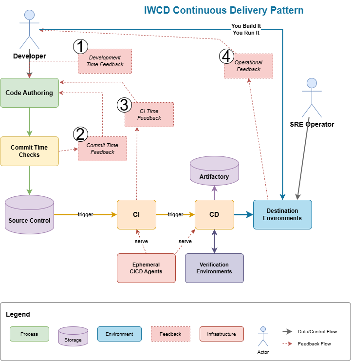

# Framework for Continuous Delivery using webMethods

This repository is reserved for the documentation of the frameworks' rules, conventions, philosophy and way of working.

## Fundamental Pattern

The IWCD framework implements a continuous delivery pattern centered on rapid feedback loops and relentless automation. Developers author code that flows through automated commit-time checks before entering source control. These checks provide immediate feedback, enabling early detection of issues. Upon commit, the CI process is triggered, executing on ephemeral agents to ensure clean, reproducible builds. CI provides additional feedback to developers and, upon success, triggers the CD process.

The CD process publishes artifacts to the artifactory and deploys to destination environments, utilizing verification environments for testing before final deployment. Critically, the pattern embraces the "You Build It You Run It" principle: developers maintain operational responsibility for their code in destination environments. Operational feedback from these environments flows back to developers, closing the feedback loop and enabling continuous improvement.

This pattern is supported by ephemeral CICD agents that provide isolation and security, while multiple feedback mechanisms (commit-time, CI-time, development-time, and operational) ensure quality at every stage. The entire flow is designed to be deterministic, automated, and secure, with no manual intervention required once code is committed.

The framework explores detailed capabilities organized against this fundamental operational pattern.

Objects that are subject to software delivery are always code. Data is expected to remain in the original environment, that is we are not moving data between environments by default. Data necessary for feedback cycles is synthetic or anonymized. A detailed description of the fundamental way of working is provided in the [Fundamental Delivery Process](delivery-process.md) document.

## Principles

- Relentless automation
- Relentless software supply chain control
- Git-first code
- Code is text
- Security by design
- Overall minimalism
- Single delivery conduit

## Constraints

- **code is text (1 - sources)** : Git repositories only contain text based code, either sources to be compiled or scripts, but also diagrams expressed in text based files. Archi tool files, drawio text based files, mermaid diagramming and similar are accepted. Snapshots of these diagrams may be used as image files in documentation, but the source text based file must always be present in the repository to allow for increments.
- **code is text (2 - no binaries of any kind)**: No binaries in git! Files like .jar, .class, .exe, .bin etc must be dealt with down the line in the pipelines using artifactories or at least dedicated storage folders.
  - **Note**: For clarity, when executing service development with webMethods, files like `.class`, `.jar`, `.frag` usually present in packages containing java services MUST be gitignored. They are compiled from sources when needed by the use of `jcode` tool.
- **Relentless software supply chain control (1 - no redistribution of software)**: No software redistribution! All the repositories are referring to and resolving dependencies at build or CI time, but the repositories themselves are not allowed to contain any other software.
- **Relentless software supply chain control (2 - BYOL)**: Using any of the capabilities here implies a "bring your own license" approach. For example, the repositories may contain microservices runtime image names, it is the duty of each user to procure a license for it before using the images.
- **Relentless software supply chain control (3 - minimalism)**: Software is a liability. Use as little dependencies as possible. For example don't add `ant` or `bash` when a simple POSIX shell does the job.
- **Security by design (1 - git exclusions)**: git repositories MUST NOT contain any of the following:
  - secrets like passwords, API Keys and so on.
  - Any form of personal data
    - **user emails are included in this rule!** Use GitHub's email anonymizing feature and then use the GitHub user id
- **Security by design (2 - code origin)**: All commits MUST be signed digitally and signed off!
- **Security by design (3 - pipeline agents enforcement)**: Pipeline agents MUST ensure appropriate isolation. Do not use cloud services allowing for escape from agent mechanics.
  - **Note**: the default configuration in this framework includes as first choice Azure DevOps ephemeral VMSS based agents, where the image used in the VMSS is custom built for security enforcement and the VMSS runs in private virtual networks.
- **Relentless automation (1 - No ClickOPS)**: Everything MUST be deterministically obtained with pipelines triggered at commit or pull request time with zero clicks! On a final production-ready delivery pipeline we pursue the objective of zero clicks, not even to set a CI pipeline parameter.

## Conventions

The default toolset for working with this repositories includes:

- A docker compose enabled user workstation
  - Rancher Desktop on Windows with WSL2 is the default assumption
  - Linux boxes with docker ce and docker compose
  - Note: we are keeping an eye on Podman Desktop for Windows, but at this point in time it does not offer the required capabilities
- Visual Studio Code with devcontainers extension
- webMethods designer with service development

Repositories come with default IDE configuration folders, like .vscode or .devcontainers for convenience. Users may feel free to modify to their own liking and keep thm gitignored as per their own preferences. However in order not to incur in unpleasant "merge because of re-formatting" activities, the following general rules, that are usually already provided in the above mentioned file SHOULD be observed:

- use devcontainers for consistency
- observe each of the devcontainer's or repository formatting rules and respect them