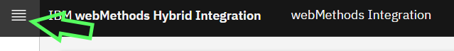
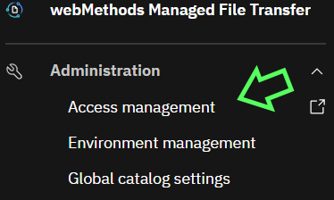
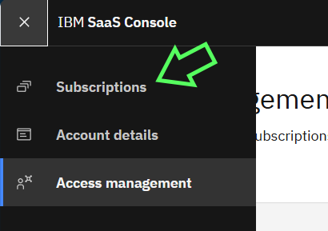
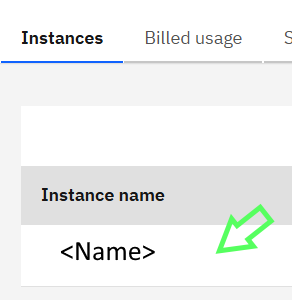
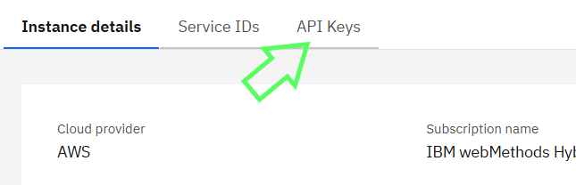
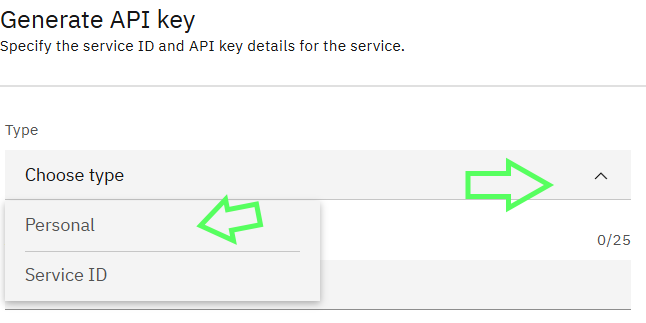

# Quick Start with IBM webMethods Hybrid Integration (IWHI) APIs Keys

If you need to work with IBM webMethods Hybrid Integration (IWHI) APIs for general configuration changes such as export and import of the assets, you need an API key. Following are the quick step to generate one starting from the tenant UI:

## Pre-requisites

You need access to the tenant against which you would call the APIs. The URL to access via a browser should be something like:

`https://<name>.int.ipaas.automation.ibm.com`

## Steps

Click on the hamburger menu on the top left:



Go to "Access Management":



This should open a new tab or window. Next, go to "Subscriptions":



Then "Subscription Details":


Then click on the subscription of interest:



Select API Keys Tab:



Click on "Generate key":


Choose Personal API Key and follow through the wizard.



Save the token ins ome safe place.


## Calling the APIs

### Integration

The quickest way to test the key is to use curl:

```sh
docker run --rm -ti alpine sh
export myKey='<yourkey>'
export myTenantUrl='https://<name>.int.ipaas.automation.ibm.com'

curl -H "X-INSTANCE-API-KEY: ${myKey}" -H "Accept: application/json" "${myTenantUrl}/apis/v1/rest/projects"
```

You should see a JSON response with a list of projects.

```json
{"output":{"projects":[{"name":"...
```

From now all all Integration documented APIs are accessible, according to the user's permissions.

### Notes

Currently, only Personal keys are supported for CRUD operations on the assets. Do not use Service ones or the "developer key" from the user profile.

## API Gateway

### Obtain an ephemeral token for the given API Key

```sh
export mySaaSInstanceId='<your_instance_id>'
export mySaasConsoleUrl="https://account-iam.platform.saas.ibm.com/api/2.0/services/${mySaaSInstanceId}/apikeys/token"

export myKey='<yourkey>'
curl -X POST -H "Content-Type: application/json" -d "{\"apikey\": \"${myKey}\"}" ${mySaasConsoleUrl}

## Extract the token from the response
export myToken='<yourtoken>'
```

### Use the token to call API Gateway's Administration APIs

```sh
export myApiTenantUrl='https://xyz.abc.apigw.ipaas.automation.ibm.com'
curl -X GET -H "Authorization: Bearer ${myToken}" "$myApiTenantUrl/rest/apigateway/alias"
``` 

## References

- [IBM SaaS Console](https://www.ibm.com/docs/en/saas-console)
- [IWHI APIs Reference](https://www.ibm.com/docs/en/wm-integration-ipaas?topic=references-public-apis)
- [webMethods API Gateway Administration APIs Reference](https://www.ibm.com/docs/en/wm-apigateway-ipaas?topic=reference-administration-apis)